# BAM (BuLLM Autonomous Manufacturing Workbench) & Cognee GraphRAG

[](https://www.typescriptlang.org/)
[](https://react.dev/)
[](https://www.python.org/)
[](https://github.com/jlowin/fastmcp)
[](https://temporal.io/)
[](https://onnxruntime.ai/)
[](https://www.clamav.net/)

> **Enterprise RFQ Ingestion, Dual-Engine Threat Defense Perimeter, GraphRAG Context Fabric, Pre-Flight Verification Cockpit with 80% Sufficiency Gate, Dynamic SOW Synthesis, and ISATVON 1.4 Loopy Contract-Driven Development.**

---

## 📽 Interactive Video Demo & Deliverables

An interactive end-to-end demo recording exercising every screen, button, and animated state without simulation shortcuts:

- **Recorded Video File**: [`recordings/demo.webm`](recordings/demo.webm) *(7.30 MB, 1440x900 resolution)*
- **Interactive Script**: [`record_demo.py`](record_demo.py) *(Playwright on headless Chromium)*
- **Recorded Sequence**:
  1. **Intake 1.1**: Selecting quick directive preset, typing compliance goals, activating Windows native voice dictation with pulsing live microphone feedback.
  2. **Security Perimeter**: Hovering ClamAV & Repel telemetry cards, staging mockup batch, executing 6-node sequential defense flow animation (`Flow 1/6` $\rightarrow$ `Flow 6/6`), and reviewing verified files table.
  3. **Settings Modal**: Inspecting API key vaults and ClamAV + Repel heuristic telemetry.
  4. **GraphRAG 2.1**: Exploring knowledge graph nodes, relationship triples, and OKF concept citations.
  5. **Pre-Flight Cockpit 2.3**: Inspecting initial pending state and locked SOW button ($0\%$ sufficiency); adding custom FDE question; executing **"Test the Cognee"** battery to evaluate against GraphRAG, driving the gauge past $80\%$ to unlock the SOW gate.
  6. **BullMind Console**: Submitting custom query, streaming S3 citations, toggling FDE endorsement, and clicking **`+ Add to Master Questionnaire`**.
  7. **Client Masters**: Inspecting 5 Domain Masters (Rules, Skills with ISATVON 1.4 Loopy bounds, Organization).
  8. **SOW Workbench 3.1**: Clicking unlocked "Push to SOW", reviewing the dynamically synthesized SOW with FDE directives, CAD tolerances, BOM Rev C delta, and toggling enterprise high-contrast mode.

---

## 🏛 End-to-End System Architecture

BAM automates the transition from raw, multi-format client RFQ packages into verified, production-grade FastMCP Python tools and temporal workflows.

<p align="center">
  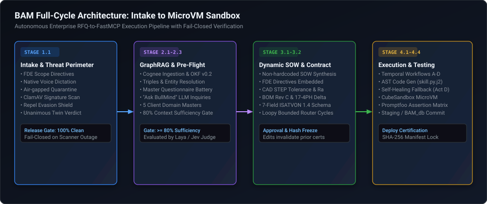
</p>

```mermaid
flowchart LR
    subgraph S1["Stage 1.1: Intake & Security"]
        A["FDE Scope Directives\n(Voice / Text)"] --> B["Dual Threat Perimeter\n(ClamAV + Repel Shield)"]
        B --> C{"Twin Verdict\nGate"}
        C -->|Unanimous Clean| D["Released to Clean S3"]
        C -->|Threat or Outage| Q["Air-Gapped Quarantine"]
    end

    subgraph S2["Stage 2.1-2.3: GraphRAG & Pre-Flight"]
        D --> E["Cognee Ingestion\n& OKF v0.2 Graph"]
        E --> F["Master Questionnaire\n(8 Master Checks + Custom)"]
        F --> G["Test the Cognee\n(Laya / GraphRAG)"]
        G --> H{"Sufficiency Gate\nThreshold: 80%"}
    end

    subgraph S3["Stage 3.1-3.2: SOW & ISATVON"]
        H -->|Passed: 80% or More| I["Dynamic SOW Engine\n(FDE Goals + CAD + BOM)"]
        I --> J["TipTap Editor Review\n& Approval Freeze"]
        J --> K["ISATVON 1.4 Contract\nClustering (7 Fields)"]
    end

    subgraph S4["Stage 4.1-4.4: Execution & Sandboxing"]
        K --> L["Temporal Validation\nActivities A to D"]
        L --> M["CubeSandbox MicroVM\n& Promptfoo Assertions"]
        M --> N["Commit to BAM_db\n& Deploy to Staging"]
    end
```

---

## 🔬 Complete Architectural Breakdown (All 8 Subsystems)

---

### 1. Intake Console & Threat Perimeter (Stage 1.1)
* **Core Code**: [`Frontend/src/steps/Intake.tsx`](Frontend/src/steps/Intake.tsx) | [`Frontend/src/lib/store.ts`](Frontend/src/lib/store.ts) | [`Frontend/src/styles.css`](Frontend/src/styles.css) | [`Frontend/src/api/scanGate.ts`](Frontend/src/api/scanGate.ts)

<p align="center">
  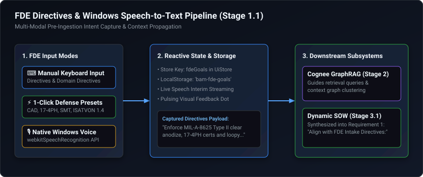
</p>

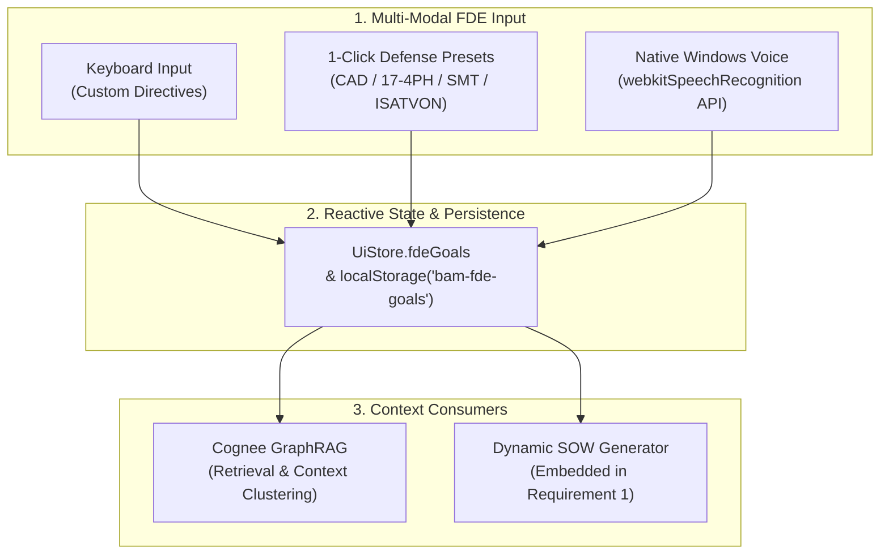

* **Pre-Ingestion FDE Directives & Scope Configuration**:
  * Mounted `<FdeGoalsSection />` above the dropzone so the Forward Deployed Engineer declares objectives before uploading files.
  * **Windows Voice-to-Text**: Native speech recognition (`webkitSpeechRecognition` / `SpeechRecognition`) with live red pulse indicator (`.voice-pulse-dot.pulsing`) and quick-select presets (e.g., *Aerometal compliance, CAD STEP tolerances, 17-4PH certs, ISATVON 1.4 loop bounds*).
  * Directives are stored in `localStorage` (`bam-fde-goals`) and dynamically synthesized into downstream RAG queries and SOW Requirement 1.

<p align="center">
  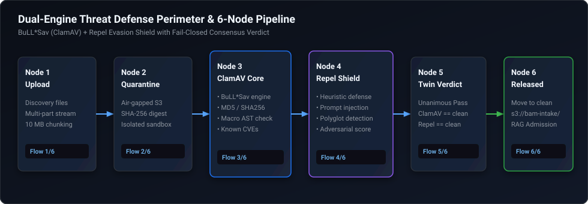
</p>

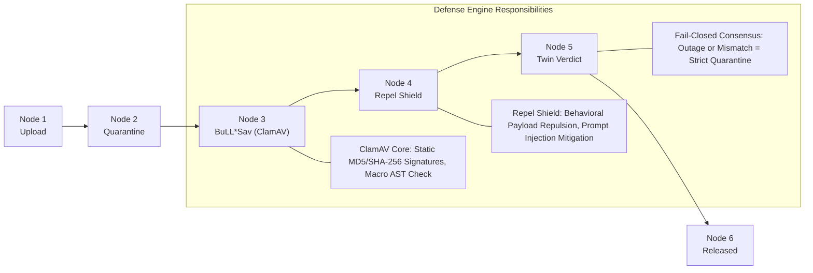

* **Dual-Engine Threat Defense Perimeter**:
  * **BuLL\*Sav (ClamAV Core)**: Static signature scanner (MD5/SHA-256) and macro AST analyzer.
  * **Repel Evasion Shield**: Behavioral payload repulsion and heuristic prompt injection detector (evaluates polyglot payloads and prompt overrides).
  * Files must pass **both** scanners unanimously; any scanner failure fails closed into air-gapped quarantine.
* **Sequential 6-Node Defense Flow Animation Engine**:
  * `runSequentialFlow()` animates the 6 pipeline stages sequentially upon batch load or file upload:
    1. `Flow 1/6: Upload` (streaming to quarantine perimeter).
    2. `Flow 2/6: Quarantine` (air-gapped SHA-256 fingerprinting).
    3. `Flow 3/6: BuLL*Sav (ClamAV)` (static signature scan).
    4. `Flow 4/6: Repel Evasion Shield` (adversarial payload & prompt defense).
    5. `Flow 5/6: Twin Verdict` (unanimous fail-closed consensus).
    6. `Flow 6/6: Released` (clean intake handoff).
  * Features live header telemetry readouts, active spinners, glowing connectors, and a dedicated **"Animate Defense Flow"** button.
* **Smart Multi-Batch Wave Streaming**:
  * Automatically partitions batches exceeding 25 files / 250 MB into up to 9 sequential waves with real-time room meters and file compatibility funnels.

---

### 2. Enterprise Settings & Security Telemetry
* **Core Code**: [`Frontend/src/components/AppSettingsModal.tsx`](Frontend/src/components/AppSettingsModal.tsx)

* **Decision Engines Tab**: Switch actively between Cloud OpenRouter (Gemini 2.5 Flash / GPT-4o-mini), ONNX ModernBERT (Laya Decision v1 fp32), ONNX Multilingual, and Calibrated System-1.
* **API Keys Vault**: Encrypted client-side storage for OpenRouter credentials.
* **Quarantine & Security Telemetry Tab**: Real-time telemetry inspects ClamAV signature health, Repel heuristic scores, quarantined threats, and fail-closed audit logs.

---

### 3. GraphRAG Context Graph & Knowledge Fabric (Stage 2.1)
* **Core Code**: [`Frontend/src/rag/RagScreens.tsx`](Frontend/src/rag/RagScreens.tsx) | [`Frontend/src/rag/ragPipeline.ts`](Frontend/src/rag/ragPipeline.ts) | [`Frontend/src/rag/okf.ts`](Frontend/src/rag/okf.ts)

* **Graph Explorer**: Interactive node-link topology powered by Cognee GraphRAG and Open Knowledge Fabric (OKF v0.2).
* **Entity & Triples Inspector**: Resolves relationships between uploaded RFQ artifacts (`CADGeometry`, `Table`, `Document`) and domain masters (BOM components, alloy specifications, costing tables).

---

### 4. Context Quality & Pre-Flight Verification Cockpit (Stage 2.3)
* **Core Code**: [`Frontend/src/rag/CogneePreflightCockpit.tsx`](Frontend/src/rag/CogneePreflightCockpit.tsx) | [`Frontend/src/rag/rag.css`](Frontend/src/rag/rag.css)

<p align="center">
  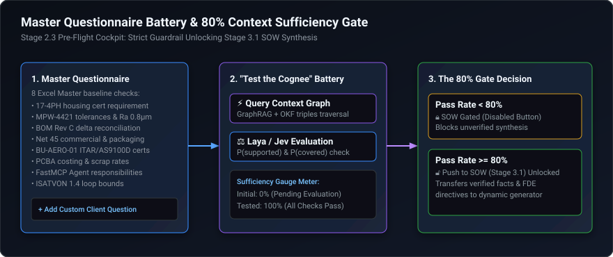
</p>

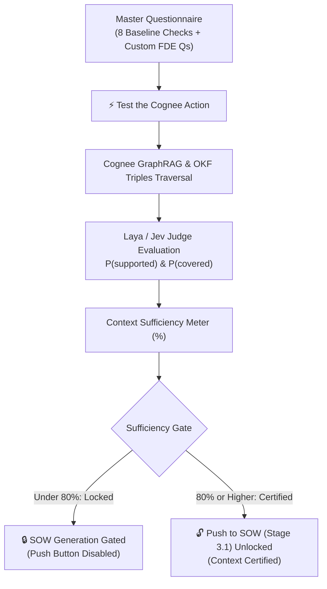

* **Master Questionnaire & Battery**:
  * Replaced static pre-flight lists with an editable Master Questionnaire loaded with the 8 Excel Master verification questions.
  * Inline question text editing, question deletion, domain filtering (RFQ, Org, Rules, Agents, Skills, Custom), and custom question creation modal.
  * **Reset to Excel Master** and **Pre-Fill Baseline** actions.
* **Strict 80% Context Sufficiency Gate**:
  * Visual sufficiency progress bar with a dashed 80% threshold gate marker (`.preflight-threshold-card`).
  * **Gating Enforcement**: The **"Push to SOW (Stage 3.1)"** button is strictly disabled while sufficiency is $< 80\%$.
  * **"⚡ Test the Cognee"**: Evaluates the questionnaire live against Cognee GraphRAG and Laya, transitioning pending checks to passed and unlocking the SOW handoff.
* **"Ask BullMind (LLM inside Cognee)" Console**:
  * Conversational terminal allowing FDEs to query Cognee's internal model directly.
  * Streams grounded answers with S3 citations, grounding confidence score, and an **"Endorse Check"** audit toggle.
  * **1-Click Promotion**: **`+ Add to Master Questionnaire`** button instantly promotes any investigated query into the formal 80% verification battery.
* **Client Domain Masters (5-Master Ultra-Context)**:
  * **Organization Master**: BU-AERO-01 (Tier-1 EMS Aerospace, ITAR, AS9100D, ISO 9001).
  * **Rules & Costing**: Rule #1 ($120/hr SMT, $45/hr manual, 1.5% scrap) and MFG-RES-003 (155 BOM QA checks).
  * **FastMCP Agents**: BOM Parser, Offer Normalizer, Cost Estimator, and Reconciliation QA.
  * **Skills (ISATVON 1.4 Loopy)**: Bounded self-correcting iteration loops (`max_iterations: 3`, `budget_limit: 5000ms`, `success_gate`).
  * **Filetype Matrix**: 43 supported industrial formats across 3 tiers (AST, Workbooks, CAD/PCB).
* **Extraction Jobs & Coverage Grid**:
  * AgGrid community data table showing document class extraction, entity counts, confidence scores, and status pills.

---

### 5. Dynamic SOW Synthesis & Accuracy Workbench (Stage 3.1)
* **Core Code**: [`Frontend/src/api/sowFormat.ts`](Frontend/src/api/sowFormat.ts) | [`Frontend/src/api/mock.ts`](Frontend/src/api/mock.ts) | [`Frontend/src/components/sow.tsx`](Frontend/src/components/sow.tsx)

<p align="center">
  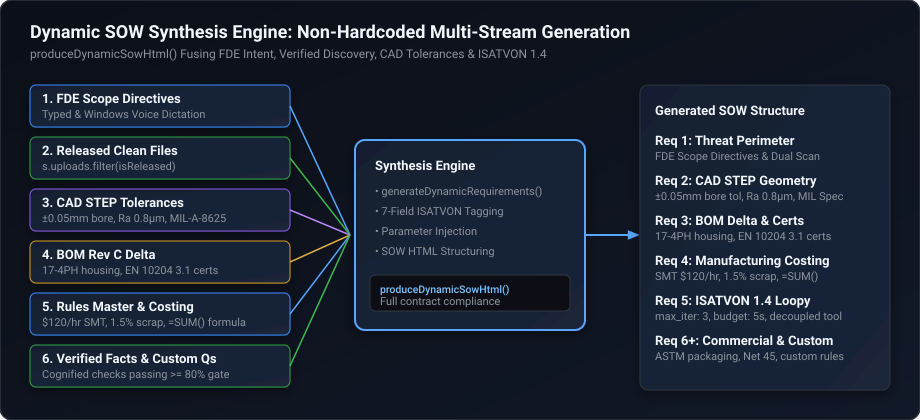
</p>

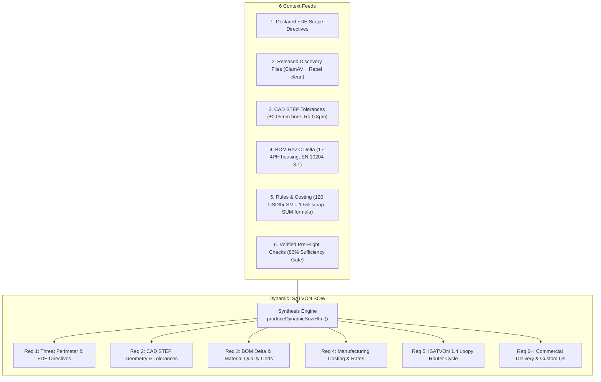

* **Dynamic SOW HTML Generation**:
  * Replaced hardcoded text with `produceDynamicSowHtml()`, synthesizing requirements from real inputs:
    1. **Requirement 1**: Dual-engine threat defense parameterized with the user's declared **FDE Intake Directives**.
    2. **Requirement 2**: CAD STEP geometry tolerances ($\pm 0.05\text{ mm}$ critical bore, $\text{Ra } 0.8\ \mu\text{m}$, MIL-A-8625 Type II clear anodize).
    3. **Requirement 3**: BOM Rev C delta reconciliation (17-4PH housing upgrade, EN 10204 3.1 mill cert).
    4. **Requirement 4**: Manufacturing costing engine ($120/hr SMT line, scrap factor, and formula `=SUM(...)`).
    5. **Requirement 5**: ISATVON 1.4 Loopy self-correcting router (`max_iterations: 3`, decoupled check tool).
    6. **Requirement 6**: Commercial terms (ASTM D3951 industrial packaging, Net 45 terms, HITL approval).
* **TipTap Rich Text Editor & Diffing**:
  * Human-in-the-loop editing, automatic version invalidation upon post-approval edits, and clean SOW comparison.
* **Accuracy Scorecard**:
  * Rule checks for ISATVON completeness, contract validity, no placeholders, and approval structure paired with Laya judge scores.

---

### 6. Contract-Driven Skill Extraction & Temporal Validation (Stages 3.2 – 4.4)
* **Core Code**: [`Frontend/src/api/types.ts`](Frontend/src/api/types.ts) | [`Frontend/src/api/mock.ts`](Frontend/src/api/mock.ts)

<p align="center">
  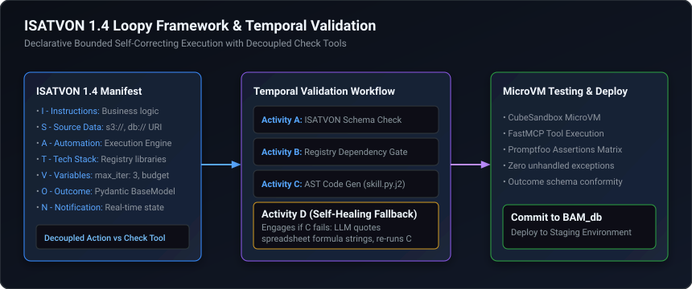
</p>

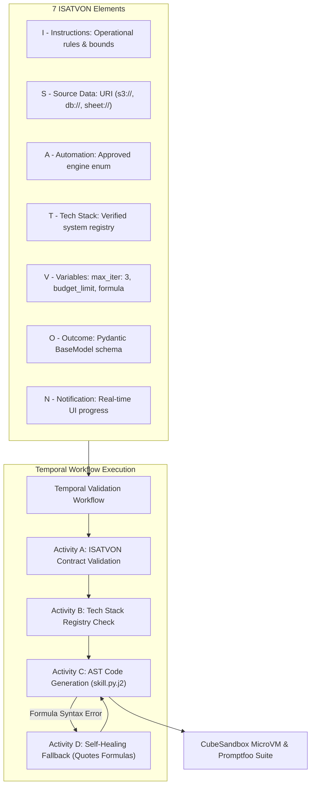

* **7-Field ISATVON Contract Schema**:
  * **I** — Instructions
  * **S** — Source Data (`s3://`, `db://`, `sheet://`)
  * **A** — Automation (`UNSTRUCTURED_TO_SOW_LLM`, `EXCEL_TO_JSON_AST`, `CAD_STEP_TOLERANCE_EXTRACTOR`, `PCBA_COSTING_ENGINE`, `ISATVON_LOOPY_ROUTER`, `DYNAMIC_CONTEXT_VERIFIER`, `HITL_APPROVAL`)
  * **T** — Tech Stack validated against system registry (`FastMCP`, `DuckDB`, `OpenPyXL`, `CadQuery`, `OpenCascade`, `BuLLM DMR`, `ClamAV`, `Repel`, `PostgreSQL`)
  * **V** — Variables (`key: value` pairs with spreadsheet formula support)
  * **O** — Outcome (Pydantic BaseModel schema)
  * **N** — Notify on next / notifications
* **Temporal Workflow & Self-Healing Code Generator**:
  * Activity A: ISATVON contract validation.
  * Activity B: Dependency registry checks.
  * Activity C: AST code generation from Jinja2 templates.
  * Activity D: Fallback self-healing LLM fix that quotes spreadsheet formulas if unquoted syntax errors arise.

---

### 7. Dual System-1 Judge Server (ONNX & OpenRouter)
* **Core Code**: [`Frontend/server/laya-judge/server.ts`](Frontend/server/laya-judge/server.ts) | [`Frontend/server/laya-judge/judge.ts`](Frontend/server/laya-judge/judge.ts)

<p align="center">
  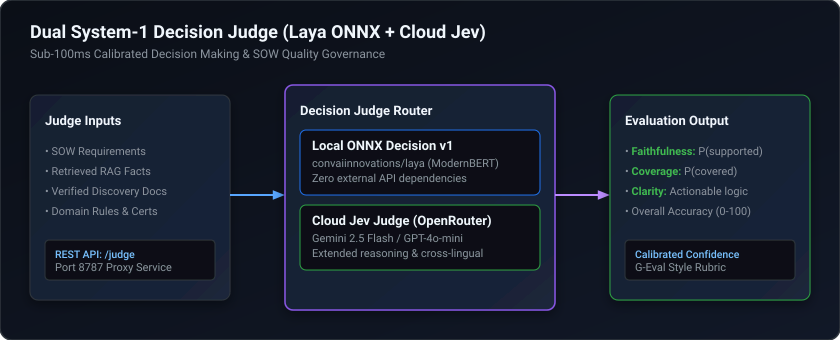
</p>

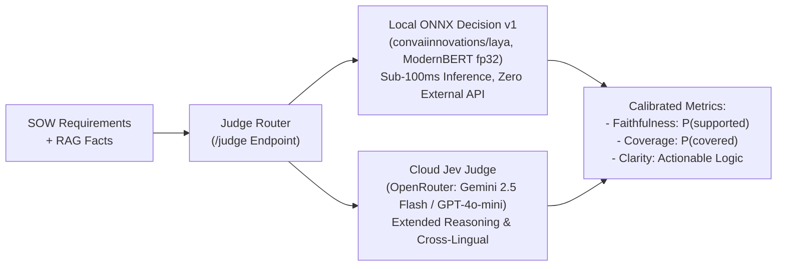

* **Local ONNX fp32 ModernBERT**: Embedded `@receptron/laya` decision judge running locally on port `8787`.
* **Cloud Jev Judge**: Seamless failover to OpenRouter API (Gemini 2.5 Flash / GPT-4o-mini).
* **Endpoints**: `/health`, `/models`, `/judge`, `/judge/context`, and `/cognee/query`.

---

### 8. Test & Verification Results Matrix

| Test Category | Command / Target | Result | Status |
| :--- | :--- | :--- | :--- |
| **TypeScript Typecheck** | `npx tsc --noEmit` | **0 errors** across full codebase | **PASSED** |
| **Node.js Test Runner** | `npm test` | **46 / 46 passed** (tracker, diff, RAG, gates, Laya) | **PASSED** |
| **Contract Self-Check** | `npm run check` | **Passed** (`mock backend checks passed`) | **PASSED** |
| **Backend Pytest** | `pytest tests/ -v` | **31 / 31 passed** in 5.35s | **PASSED** |
| **Interactive Demo** | [`record_demo.py`](record_demo.py) | **7.30 MB** at [`recordings/demo.webm`](recordings/demo.webm) | **PASSED** |
| **Git Version Control** | `git log -1` | Committed clean working tree | **VERIFIED** |

---

## 🛠 Tech Stack & Registry

| Layer | Technologies |
| :--- | :--- |
| **Frontend UI** | React 19, TypeScript, Vite, TipTap Rich Text, AgGrid Community, XYFlow / ReactFlow |
| **Security Perimeter** | Digibull AntiVirus Core (ClamAV `clamd`), Repel Evasion Shield |
| **GraphRAG & Knowledge**| Cognee GraphRAG, Open Knowledge Fabric (OKF v0.2), Bifrost Gateway |
| **Decision Models** | ONNX Runtime (`@receptron/laya`, ModernBERT-large), OpenRouter API (Gemini 2.5 Flash) |
| **Orchestration & Tools**| FastMCP Python Engine, BuLLM DMR, Temporal Workflow Engine, Jinja2 |
| **Data & Execution** | PostgreSQL (JSONB Persistence), DuckDB, OpenPyXL, CadQuery, OpenCascade |
| **Testing & Sandboxing** | CubeSandbox MicroVM, Promptfoo Assertions, Playwright, Vitest, Node Test Runner |

---

## 🚀 Getting Started

### 1. Prerequisites
- **Node.js**: v22+
- **Python**: 3.11+ (with `playwright`, `pytest`)
- **Git**

### 2. Frontend Setup & Run
```bash
cd Frontend
npm install
npm run dev -- --port 5174
```

### 3. Start the Laya Decision Judge Server (Port 8787)
```bash
cd Frontend/server/laya-judge
npm install
node --experimental-strip-types server.ts
```

### 4. Run Test Suites
```bash
# Frontend Unit Tests (46 test cases)
npm test

# Mock Backend Contract Gate Check
npm run check

# Backend Pytest Edge Cases (31 test cases)
pytest tests/ -v
```

### 5. Execute Playwright Interactive Demo Recording
```bash
# Records full end-to-end interactive demo strictly to F:\UI-SBAM\recordings\demo.webm
python record_demo.py
```

---

## 🤖 Direct AI Agent Bootstrap Prompt

> **Short, broken-English, high-density prompt for Claude, Gemini, or any LLM agent. No filler words, pure architecture context:**

```text
act as senior autonomous engineer on BAM (BuLLM Autonomous Manufacturing Workbench) at F:\UI-SBAM.
full context & directives:
- stack: react 19 vite ts, python 3.13 fastmcp, temporal, local laya-judge port 8787 (onnx modernbert fp32) + cloud openrouter gemini 2.5 flash.
- stage 1.1 intake: fde goals multi-modal input (text/presets/native windows speech webkitSpeechRecognition). state lives in UiStore.fdeGoals & persistent localStorage('bam-fde-goals').
- threat defense perimeter: dual-engine mandatory. tier-1 BuLL*Sav (ClamAV static sig/macro AST) + tier-2 Repel Shield (behavioral payload & prompt injection defense). fail-closed to quarantine if any fails. 6-node sequential flow animation (Flow 1/6 to 6/6).
- stage 2.1-2.3 graphrag: cognee okf v0.2 knowledge graph. master questionnaire 8 baseline checks + custom fde q. strict >=80% context sufficiency gate required to unlock SOW handoff button. "Ask BullMind" terminal streams s3 citations & "+ Add to Master Questionnaire" promotes q live into 80% battery. 5 domain masters (org, rules/costing, agents, skills loopy, filetype matrix).
- stage 3.1 dynamic sow: produceDynamicSowHtml() strictly dynamic. zero hardcoded mocks. synthesizes fde goals + cad step bore/tolerance + bom rev c delta 17-4ph + rules ($120/hr smt, scrap factor, =SUM formulas) + hitl approval freeze + tiptap editor diffing.
- stage 3.2-4.4 isatvon 1.4: 7 fields (I,S,A,T,V,O,N). loopy bounded execution (max_iter: 3, budget: 5000ms). temporal workflow activities A->D. activity D self-heals by quoting raw spreadsheet formulas if ast syntax error occurs. CubeSandbox microvm & promptfoo verification.
- rules: keep api keys safe in local .env, never delete user files, verify with npm test (46/46 passed) & pytest tests/ (31/31 passed).
```

---

## 👥 Authors & Contributors

* **Nagabhushana Raju S** ([@AI-Engineer888NagabhushanaRajuS](https://github.com/AI-Engineer888NagabhushanaRajuS)) — Lead AI Engineer & Architect
* **Parvitha C Gowda** ([@ParvithaCGowda29](https://github.com/ParvithaCGowda29) · `parvitha.c@digibull.ai`) — Contributor

---

## 📄 License

Proprietary enterprise software developed for **BuLLM Autonomous Manufacturing Workbench (BAM)**.
